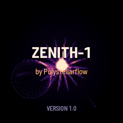
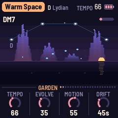
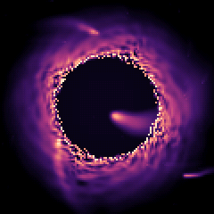

# ZENITH-1 for the M-VAVE FM-1

ZENITH-1, by Polystellarflow, turns the M-VAVE FM-1 into a generative ambient machine. It is built on
[AMB-1](https://github.com/charlesvestal/fm1-amb) by Charles Vestal, with its engine, its controls and its way of
working: it plays itself from the moment it's switched on, and you tend it like a garden.

Breathing pads bloom and fade on cycles of unequal length. Shimmering bells play from tape loops 13, 17, 23 and 29
beats long, as in *Music for Airports*. Under them are a gliding bass, soft Euclidean percussion and a texture of air;
over them, now and then, a lead (sax, flute, muted trumpet and more) plays melodies of its own. All of it goes through a
tape echo, a long tape loop and a shimmering plate reverb. Left alone it travels, as HADAL-1 does:
through the parts of a world, from era to era (new loops, new sounds, a new key), and from one of its eight worlds into
another. An FX menu puts 27 effects on the keys (and plays them by itself if you like), the keys can strum the chord or play the lead, and full-screen pictures move
with the music, changing shape and colour by themselves. Steer it closely, or
let it drift for hours; it never plays the same way twice.

  

## In short

| | |
|---|---|
| Keys | The scale: each key adds its note or takes it out (in the FX menu: the effects) |
| PLAY · REC · EDIT | Grow / rest · freeze · EDIT held: Random (SAVE held: undo) |
| HOME | The Garden; again, the Journey; again, the picture |
| ENV · ARP · LFO · SEQ · SEL · GLO | The pages: Pad, Bells, Bass, Pulse and Lead, Space, Setup; press a button again for its next page |
| FX | The FX menu: tap a key for an effect; FX again: back. On any page: hold FX and press a key |
| SELECT | The previous or next page; with HOME held, the tempo |
| ALGORITHM · PRESETS | The mode · the world |
| OCT− / OCT+ | The bells' octave |
| SAVE | Saves; held, puts the world back to its recipe |

GLO pressed four times shows the Guide: every button and shortcut. The [manual](docs/MANUAL.md) has the rest.

## The worlds

Warm Space · Cinematic · Lo-fi · Glass · Kankyō · Gamelan Dawn · Deep Water · Airports

## The sounds

Pad: Warm, Strings, Choir, Rhodes, Glass, Breath, Organ, Juno, Bowed, Halo, Dream. Bells: Soft, Felt, Celesta,
Marimba, Vibes, Gamelan, Crystal, Kalimba, Music box, Bowl, Chime, Harp, Steel. Bass: Sine, Warm, Round, Drone, Moog,
Pluck, Throb. Kits: Soft, Brush, Wood, Gong, Hands, Glitch. Air: Drips, Frogs, Wind, Sea, Rain, Leaves, Night, Stream, Birds, Cosmos.

## Building, testing, installing

See [BUILDING.md](BUILDING.md). In short, on Linux or WSL:

```
./build.sh --release 1.0              # app/build/zenith-1.0.fwsc
./make_install_page.sh 1.0            # then http://localhost:8765/install/ in Chrome or Edge
sh tests/run_tests.sh                 # the engine, the app in the simulator, the browser emulator
```

## Credits

ZENITH-1 is by Polystellarflow. It is AMB-1, grown: Charles Vestal's engine, controls and structure (MPL-2.0), with
its ideas from Brian Eno's
generative music (*Music for Airports*' tape loops of unequal length, and the echo chain of *Discreet Music*). The
plate is Jon Dattorro's ("Effect Design, Part 1", JAES 1997), as in FoMni-1. The Euclidean rhythms are Godfried
Toussaint's reading of Bjorklund's algorithm. The journey, the FX menu and the picture's feedback field come from HADAL-1. It is built on
[fm1-base](https://github.com/charlesvestal/fm1-base) and [felucca-bsp](https://github.com/hugelton/felucca-bsp),
from [Felucca](https://github.com/hugelton/Felucca) by Leo Kuroshita (Hügelton Instruments). MPL-2.0; see
[LICENSING.md](LICENSING.md).

M-VAVE and FM-1 are trademarks of their owners. ZENITH-1 is not affiliated with M-VAVE, Brian Eno, Charles Vestal or
Hügelton Instruments.
