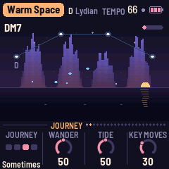
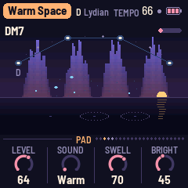
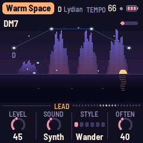
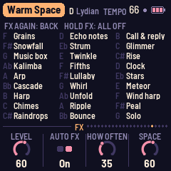
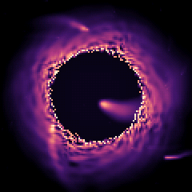
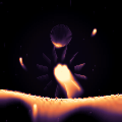

# ZENITH-1

ZENITH-1, by Polystellarflow, turns your M-VAVE FM-1 into a generative ambient machine. It is built on Charles
Vestal's AMB-1 and works the same way: switch it on and it plays by itself. You don't perform it so much as tend it,
like a garden. Left alone, it travels: through the parts of a world, from era to era, and from world to world.

Breathing pads bloom and fade. Shimmering bells play from tape loops of unequal length, as in Brian Eno's *Music for
Airports*. Under them are a gliding bass, soft Euclidean percussion and a texture of air; over them, now and then, a
lead voice (a sax, a flute, a muted trumpet and more) plays melodies of its own. All of it goes through a tape
echo, a long tape loop and a shimmering plate reverb. There are eight worlds, each with its own sounds, scales, tempo
and space, and when you leave it alone, full-screen pictures move with the music.

, running ZENITH-1, each control labeled")

---

## Contents

1. Install
2. Getting started
3. Controls
4. The screen
5. The garden
6. The journey
7. The worlds
8. The pages
9. Wander: steer it, or let it drift
10. The FX menu
11. The picture
12. Speaker and headphones
13. MIDI and the screen reader
14. Saving
15. Parameters
16. Credits

---

## 1. Install

Build ZENITH-1 and start its install page (see BUILDING.md), then open <http://localhost:8765/install/> in Chrome or
Edge. Connect the FM-1 with a USB data cable and press Install. Don't unplug it while it's writing. When it's done,
the FM-1 restarts into ZENITH-1.

The same page has the browser emulator (<http://localhost:8765/emu/>), the same code with sound, played with a mouse,
a touch screen or the keyboard.

To go back to M-VAVE's firmware, use "Back to the stock firmware" at the bottom of the install page.

> Installing other firmware is at your own risk. If the FM-1 ever won't start, see
> [Troubleshooting](#troubleshooting).

---

## 2. Getting started

ZENITH-1 starts playing as soon as you switch it on. A title rises first (ZENITH-1, by Polystellarflow, and the
version); any key or button skips it. Then:

1. **Listen.** The first world, Warm Space, starts at dawn: a warm pad alone, blooming. Bells, the bass and the rest
   come in as the world moves into its next parts. Turn MASTER to set the volume.
2. **Leave it.** It changes by itself: it plays in parts, every minute or few, and every quarter of an hour or so a new
   era comes with new loops, new sounds and maybe a new key. On the default Journey setting, Often, every era
   dissolves the world, and another one rises in its place. No two runs are the same: it starts from a new seed every
   time it's switched on.
3. **Change worlds.** Turn PRESETS. Each of the eight worlds has its own key, tempo, sounds and space.
4. **Change the scale.** Press a key whose note is lit to take that note out of the scale. Press it again to bring it
   back. Press a key that isn't lit to add its note.
5. **Roll the dice.** It moves on by itself; when you want something new now, hold EDIT for **Random**: new sounds for
   every layer, a new key, mode, tempo, space and levels, all in ranges that sound good. Hold it again for another
   roll. To undo, hold SAVE: the world goes back to its own recipe.
6. **Play the effects.** Press FX. Now all 27 keys play effects: tap one and it plays once. Press FX again to go back. Effects also play by themselves now and then (Auto FX, on the FX page).
7. **Shape a layer.** ENV is the pad, ARP the bells, LFO the bass, SEQ the pulse and the lead, SEL the space, HOME the
   garden and the journey, GLO the setup. KNOB 1–4 set the four values at the bottom of the screen. Press the same button again
   for that layer's next page.
8. **Watch.** Leave it alone for 30 seconds, or press HOME three times, and the screen becomes a picture that moves
   with the music. Touch anything to bring the pages back.
9. **Freeze or rest.** REC holds the chord and lets the reverb ring on forever. PLAY rests the garden; press it again
   and it grows back.

Each world keeps what you change. ZENITH-1 saves by itself while it rests, or you can press SAVE.

Press GLO four times for the **Guide**: every button and shortcut on one page.

---

## 3. Controls

| Control | What it does |
|---|---|
| Keys | The keys are the scale, and they light up for the notes in it. Press a key to add its note or take it out. Every octave of a note is the same key. The root always stays, and the scale keeps at least three notes. In the FX menu, the keys play the effects instead. |
| PLAY | Grows or rests the garden. It grows by itself from power-on. Resting, the sounds fade out and the reverb rings away. |
| REC | Freezes the chord. The reverb rings on forever, the bells and pulse go on above it, and the picture holds still. Press REC again to thaw. |
| EDIT | Hold it for 1.5 s for **Random**: new sounds and settings, rolled. Hold SAVE to undo (the world's recipe again). A tap does nothing: the music moves on by itself. |
| HOME | The Garden page; again, the Journey page; again, the picture. |
| ENV · ARP · LFO · SEQ | The Pad, Bells, Bass and Pulse pages. Each has a second page for its shape: press the button again. SEQ goes on to the Lead and the Lead's shape. |
| SEL | The Space page; again, Tape; again, Air. |
| FX | The FX menu: the keys play the effects. Press FX again to go back to the page you were on. Hold FX in the menu to let every effect go. On any other page, hold FX and press a key to play its effect without the menu. |
| GLO | The Setup page; again, Sleep; again, the Picture page; again, the Guide (every button and shortcut). |
| SELECT | Turns to the previous or next page. To change the tempo from any page, hold HOME and turn SELECT. |
| ALGORITHM | Picks the mode: Ionian, Dorian, Phrygian, Lydian, Mixolydian, Aeolian, pentatonic major or minor, the Japanese yo scale, or Balinese pelog. It loads the mode's scale. Once you change the scale with the keys, it's Custom. |
| PRESETS | Picks the world. For the list, see [The worlds](#7-the-worlds). |
| KNOB 1–4 | Set the four values on the screen. A few clicks always move one step at a time, and a quick turn speeds up, so half a turn sweeps the whole range. |
| OCT− / OCT+ | Move the octave of the layer whose page you're on: the pad on the Pad pages, the bass on the Bass pages, the lead on the Lead pages, the bells everywhere else. |
| MASTER | Sets the volume. |
| SAVE | Saves all eight worlds. Hold it for 1.5 s to put the world back to its recipe: the screen says RESET: SAVE TO KEEP. Until you save, switching off brings your version back. |

Press GLO four times for the **Guide**: every button and shortcut on one page, on the FM-1 itself.

")

---

## 4. The screen

")

- The top line shows the world, its root and its mode. On the right are a play triangle while resting, the tempo
  (TEMPO 66; EXT when it follows MIDI clock), a dot when there are unsaved changes, and the battery.
  Messages such as "ADDED F#" and "NEXT PART" show here for a moment.
- The garden is a night horizon:
  - At the top left: the chord's name.
  - At the top right, a thin bar fills up on the way to the next chord ("held" while frozen); under it, for a few
    seconds, the effect that last started.
  - **The constellation:** an arc of twelve places across the sky, the root at the left, named. The scale's notes
    are faint stars, the chord's are bright ones joined by lines.
  - **The orbits:** the four bell loops, from the inside out, around the middle of the horizon. The small lights on
    each orbit are its notes. Each loop's planet goes round as the loop plays and flashes when it rings a bell.
  - **The aurora:** four curtains, one for each pad voice, rising and fading as each voice breathes.
  - **The moon:** the bass, on the horizon at the right, swelling as it plays, its path on the water below.
  - **The ripples:** the pulse, one ripple on the water for each hit.
- At the bottom are the page's name and a dot for every page (the dots of the button you're on are brighter), then
  its four values, one for each knob. The one you're turning lights up.
- ZENITH-1 watches how hard the FM-1 is working by itself. If it's ever too busy for a new effect, the FX menu's top
  line says so for a moment.

---

## 5. The garden

ZENITH-1 grows five layers and a texture from one scale and one chord.

- The **pad** is four breathing voices. Each one swells in, hangs and fades on its own cycle, of unequal lengths. Each
  voice takes its note of the chord as it starts, so the chord forms and dissolves instead of sitting still. As a
  voice swells, its filter opens: the pad blooms. Every so often (set by **Drift**), the chord moves to another one in
  the scale. Voices on notes the new chord shares hold to the end of their breath; the others fade and breathe in again
  on their new notes. A slow ensemble, its four delays each swaying on their own, makes it wide.
- The **bells** are played by four tape loops of unequal length (13, 17, 23 and 29 beats to begin with). Each loop
  holds a few notes, so the loops slide against each other and the melody never quite repeats. Each loop has its own
  shade of bell. With **Shimmer**, each bell rings with a twin a few cents apart.
- The **bass** plays the chord's root, low, soft and gliding, and sometimes leans on the fifth.
- The **pulse** is three voices, each on its own Euclidean pattern over 16, 12 and 7 sixteenths, so they make
  polyrhythms. The patterns slowly turn, and gain or lose a hit. All its kits are tuned to the chord.
- The **lead** plays melodies of its own, now and then: phrases from the scale over the chord, with rests between. It
  remembers its last phrase and often answers it, the same rhythm moved and its ending changed, so it sounds written
  rather than random. Each world has its own lead and its own way of playing.
- The **air** is a quiet texture under it all.

Each world has its own way with chords. Some like sevenths, others add a ninth, hang on a suspended second, or stack
fourths. Gamelan Dawn is tuned as a Balinese gamelan is, a little away from the piano's notes.

Then comes the space, after Eno's chain for *Discreet Music*: a short tape echo, a long tape loop up to 5.6 seconds
with two heads (each repeat darker and thinner), and a plate reverb. **Shimmer** feeds the plate's tail back into it
an octave up, so it climbs and fades. The plate only takes what is above about 200 Hz, so the tail never turns to
mud, and **Size** changes how long it rings, not how loud.

Under the journey, three smaller things keep it moving:

- A slow **tide** swings between sparse and full over a few minutes. **Motion** sets how far it swings, and how far
  the smaller things wander: pitch, pan, the vowel and the echo's heads. 
- With **Evolve** up, the bell loops change a note now and then, and the layers take rests.
- **Wander** lets every value drift around where you set it (see [Wander](#9-wander-steer-it-or-let-it-drift)).

---

## 6. The journey

Left alone, ZENITH-1 travels, as HADAL-1 does.

**Parts.** A world plays in parts, each one to three minutes long, one leading to the next by chance, each a different
balance of the layers:

| Part | What you hear |
|---|---|
| Dawn | The pad alone, dark, a few bells, a faint pulse |
| Bloom | The pad and the bells, the bass and the pulse coming in, the lead now and then |
| Flow | Everything: the pulse at its fullest, the lead |
| Shimmer | The bells in front, more of them, brighter, more shimmer |
| Deep | The bass and a low pad, few bells |
| Dissolve | Almost nothing: the pad thinning, the air |

At each new part, a bell loop starts a new phrase, and as the loops play their phrases are rewritten now and then.

**The motif.** Every minute or two the bells play a short motif of three to six notes, and each time it comes back
changed: up a step, upside down, backwards, slower or an octave up. The loops step back while it plays.

**Eras.** Every 15 to 40 minutes (5 to 15 with Journey on Often) comes a new era:
- The loops take new lengths: four different primes from 7 to 37 beats.
- There's a new motif, and the lead forgets its old phrases.
- The pad and the bells may take other sounds from the world's family.
- With Key moves up, the key may move up or down a fourth, a fifth or a step, or come home.
- The pace leans a little faster or slower.
- The pulse patterns start afresh.
- What you turned by hand is free to wander again.

**New worlds.** With Journey on Sometimes, half the eras end the world; on Often, every one does. The world dissolves, and
another one rises at dawn, with its own sounds, key, tempo, space and picture.

Set it on the Journey page (HOME, twice):

| Journey | What it does |
|---|---|
| Off | No parts, no eras: AMB-1's garden, with Wander |
| Stay | Parts and eras, always in the same world |
| Sometimes | Parts, eras, and now and then a new world |
| Often | Every era ends in a new world: a new world every 5 to 15 minutes (the default) |

It all happens by itself: there is no button for a part or an era. Hold EDIT for Random when you want something new
now (see Getting started).

---

## 7. The worlds

Turn PRESETS to choose one of eight worlds. Each is a recipe for the whole garden: the sounds of every layer, the
tempo, key and mode, the way it voices its chords, how loosely the bells fall, the space, the effects it likes to play
by itself, and the picture's colours. Each one remembers how you left it. To put the world you're on back to its
recipe, hold SAVE for 1.5 s.

| World | Key, tempo | Its sounds | Its lead | Its space and colours |
|---|---|---|---|---|
| **Warm Space** | D Lydian, 66 | a warm pad that blooms, soft shimmering bells, a deep sine bass, a soft pulse | Synth, wandering | a shimmering plate; nebula |
| **Cinematic** | C Aeolian, 58 | a slow string ensemble, felt-piano bells, a held drone of root and fifth, hands | Trumpet, a hymn | a long, wide hall; golden hour |
| **Lo-fi** | F Dorian, 78, swung | a Rhodes with tremolo, vibraphone, a warm bass, brushes | Sax, call and answer | tape wow, short echoes, vinyl crackle; warm tape |
| **Glass** | A pentatonic major, 80 | a glass pad, crystal bells an octave up, glitch | Glass, arpeggios | heavy shimmer, a breath of wind; aurora |
| **Kankyō** | G yo scale, 70 | a soft Rhodes, marimba, a round bass, wood and shaker | Flute, sparse | echoes, soft rain; sakura |
| **Gamelan Dawn** | E pelog, 72, gamelan tuning | gamelan bells in beating pairs, gong and kettles | Ocarina, an ostinato | a wide hall, dawn wind; dawn |
| **Deep Water** | A Aeolian, 50 | sung voices, soft low bells, a gliding sub bass, hands | Clarinet, a hymn | a long tape loop, the sea; ocean |
| **Airports** | C# Ionian, 60 | AMB-1's sung voices and slowed felt-piano bells, after Eno's "1/1" and "2/1", a soft pulse | Whistle, sparse | AMB-1's chain; moonlight |

---

## 8. The pages

Each button has one page or more: press it once for its first page, again for the next. KNOB 1 is always a layer's
level on its first page. Turn SELECT to step through all twenty-one pages in order.

### HOME: Garden, Journey

- **Tempo** goes from 30 to 120. You can also hold HOME and turn SELECT from any page. The garden glides to a new
  tempo over a few seconds.
- **Evolve** sets how restless the garden is. At 0, the loops repeat exactly. Turn it up, and now and then a bell note
  changes or moves as its loop comes round, the pulse patterns turn and gain or lose a hit, and the layers take rests.
- **Motion** sets how far the tide swings, and how much the pitch, pan, vowel and echo wander.
- **Drift** sets how long a chord lasts before it moves on, from 20 seconds to 5 minutes, each time a little more or
  less.
- **Journey** (second page): Off, Stay, Sometimes or Often (see [The journey](#6-the-journey)).
- **Wander**: how far every value drifts by itself (see [Wander](#9-wander-steer-it-or-let-it-drift)).
- **Tide**: how slowly the music swells and ebbs.
- **Key moves**: how often the key leaves home, at a season or an era.

Press HOME a third time for the picture.

### ENV: Pad, Pad shape, Pad breath

- **Pad breath** (third page, ENV again): **Attack**, how slowly each breath rises, and **Release**, how slowly it
  falls away. Both long and the pad is a slow tide; both short and it pulses.
- **Level** sets the pad's volume.
- **Sound**, fifteen of them:
  - Warm: three saws, one an octave down, through a filter that blooms
  - Strings: a slow ensemble with vibrato
  - Choir: sung voices through two formants
  - Rhodes: an FM electric piano with tremolo
  - Glass: pure partials, a slowly beating octave
  - Breath: air on the note
  - Organ: a reed, a square and its octave
  - Juno: a pulse whose width wanders, beside a saw
  - Bowed: one bowed string, with a resonant body
  - Halo: sines, octaves and twelfths, beating slowly
  - Dream: an FM bell that breathes
  - Brass: two saws, a soft brass swell
  - Ether: a saw and a sine with air on them
  - Cathedral: an organ's flue pipes
  - Resonant: two saws through a filter that sings as it opens
- **Swell** sets how long the voices breathe, from a few seconds to about half a minute.
- **Bright** sets how far the filter opens as the pad blooms (with Choir, the vowel).
- **Warmth** (second page) darkens and softens the whole pad.
- **Movement**: the ensemble's depth, how far the voices spread, the vibrato, the Rhodes' tremolo.
- **Space**: how much of the pad goes to the echo and the reverb.
- **Width**: how far apart the voices and the ensemble spread.

### ARP: Bells, and Bell shape

- **Level** sets the bells' volume.
- **Sound**, eighteen of them: Soft (AMB-1's FM bells), Felt (a slowed, felted piano), Celesta, Marimba, Vibes
  (Shimmer is its motor), Gamelan (metallophone pairs), Crystal, Kalimba, Music box, Bowl (a singing bowl, slow and
  beating), Chime (a tubular bell), Harp, Steel (a steel pan), Glock, Windchime, Tingsha (two small cymbals, beating),
  Dulcimer and EP bell (an electric piano's tine).
- **Density** sets how many notes each loop holds, from none to five.
- **Tone** goes from round and softly struck to bright and ringing.
- **Octave** (second page) moves the bells up to two octaves down or up. OCT− and OCT+ do the same.
- **Shimmer**: each bell's twin, a few cents apart; with Vibes, the motor's depth.
- **Space**: how much of the bells goes to the echo and the reverb.
- **Decay**: how long they ring, from a third as long to three times.

### LFO: Bass, and Bass shape

- **Level**, **Sound** and **Octave** (one down, home, one up).
  - Sine
  - Warm
  - Round
  - Drone: the root and its fifth, held, never resting
  - Moog: a resonant filtered saw
  - Pluck: each note plucked, then a soft hold
  - Throb: it pulses in half notes
  - Upright: plucked and woody
  - FM: a DX-style bass
  - Reese: two saws, slowly beating
- **Glide**: from a quick step to over a second.
- **Fifth** (second page): how often the bass leans on the fifth, halfway through a chord.
- **Warmth**: how dark and round it is. **Movement**: a slow breath in its level and pitch. **Space**: how much goes
  to the reverb.

### SEQ: Pulse, Pulse shape, Lead, Lead shape

- **Level**, **Kit** (Soft: AMB-1's thump and hats; Brush; Wood: a block, a shaker, a click; Gong: a gong and two
  kettles, as a gamelan's; Hands: a frame drum, a tabla's ring, a slap; Glitch: blips, ticks and chirps; Lo-fi: a dusty
  kick, a soft snare, a dull hat; Toy: a small tom, a toy piano's tine, a ping; Drops: water drops and a soft splash;
  Dub: a deep kick, a ringing rimshot, a shaker; 808 Soft: the boom and clap, rounded; Shaker: a felt kick, soft claps,
  shakers; Glass: tiny glassy clicks and ticks),
  **Hits** (how
  many beats the three rings play; at 0, no pulse) and **Swing** (from straight, 50%, to a heavy lilt, 75%).
- **Tone** (second page): from dark to bright. **Movement**: how often the patterns change, and how much the hits vary
  in strength. **Space**: how much goes to the reverb. **Width**: how far apart the three are.
- **Lead** (third page, SEQ again): **Level** (0 is off), **Sound** and **Style**, and **Often** (how often it plays, and
  how short its rests are).
  - Sounds: **Sax** (a breathy reed, brighter the harder it's blown, a growl at the start of a phrase), **Flute**
    (breath and a chiff), **Trumpet** (muted, nasal), **Clarinet** (hollow, woody), **Whistle**, **Glass** (an FM
    lead that strikes like a bell), **Synth** (a soft lead that swells open, as an old polysynth's) and **Ocarina**. Also
    **Harmonica** (a reed with a cupped hand's wah, bending up into notes), **Pan flute** (hollow and breathy),
    **Oboe** (a nasal reed), **Theremin** (eerie, wide vibrato, long glides), **Flugel** (a flugelhorn: soft, round
    brass), **Square** (a soft, warm square-wave synth), **Voice** (a soft "ooh") and **Cello** (bowed, low,
    singing).
  - Styles: **Wander** (a free walk, home to a chord tone), **Answer** (a call, then its answer), **Arpeggio** (up
    and down the chord), **Ostinato** (a short figure, again and again, a note changing each time), **Hymn** (long
    notes, stepwise) and **Sparse** (a note or three, much space).
- **Tone** (Lead shape, fourth page): darker or brighter. **Space**: how much goes to the echo and the reverb.
  **Vibrato**: how much it sings (and breathes, and growls). **Glide**: how much it slides between notes and bends up
  into them: 0 none at all, 20 a little (the default), 100 long glides. On the Lead pages, **OCT− / OCT+** move the
  lead's octave.
- **Lead breath** (the last SEQ page): the lead's **Attack** and **Release**. They shape every lead note, whether the lead plays by itself or you play it.
  From a quarter to four times the sound's own speed (50, the middle, is the sound as it was made).
- **Keys** (after Lead breath, SEQ six times): what the keys do, everywhere but the FX menu.
  - **Keys: Scale** (the default): a key adds its note to the scale or takes it out.
  - **Keys: Strum**: a key strums the chord like a harp, from that key's note up: six strings, quickly. It is heard
    clearly over the music, whatever the Bells level. MIDI notes strum too.
  - **Keys: Play**: the keys play the lead, one voice, held as long as you hold the key (with two held, the last one
    sounds). It rises over the music, and the music steps back a little while you hold a note. MIDI channel 1
    plays it too.
  - **Strum**: which bell sound Strum plays (Harp by default; any of the eighteen). **Strum vol**: how loud Strum is
    (only Strum: the lead you play with Keys: Play has the Lead's own Level).

### SEL: Space, Tape, Air

- **Echo** sets how much goes to the echoes. **Echo time** sets the tape loop's length: a dotted quarter, a half, a
  dotted half, or 1, 2 or 4 bars (shortened to fit 5.6 seconds). **Reverb** sets how much goes to the plate. **Size**
  sets how long the plate rings, from a room to a long hall, and how many times the echo comes back.
- **Shimmer** (Tape page): the plate's tail an octave up, fed back. **Warmth**: the plate darker and softer.
  **Tape**: wow and flutter on the pitch, and a soft saturation on the echoes. **Width**: how wide the space is.
- **Level**, **Sound** (Drips: water dripping in a cave, Frogs: croaking at night, Wind, Sea, Rain, Leaves: a rustle in gusts, Night: crickets, Stream, Birds, Cosmos: a low resonant
  drift), **Tone** and **Movement** (Air
  page): the texture.

### FX: the FX menu

**Level**, **Auto FX** (On or Off), **How often** and **Space**. See [The FX menu](#10-the-fx-menu).

### GLO: Setup, Sleep, Picture, Guide

- **Root** sets the key's root note, and the scale moves with it. **Tune** fine-tunes by up to 50 cents either way.
  **MIDI out** turns MIDI out on or off. **Lights**: On (the keys light the scale and the unlit buttons glow dimly),
  Keys (only the keys) or Off.
- **Sleep** (second page): Off, or 30, 60 or 90 minutes. From when you set it, it plays on, fades over the last
  minute, and rests. PLAY wakes it, and the timer starts again.
- **Picture** (third page): **Auto** (the default: any of the sixteen, a new one every half minute or so), the
  world's own pictures, or one of the sixteen, held. **After**: how long nothing has to be touched before the picture
  comes: never, 10 s, 30 s, 1 or 3 minutes. **Colours**: **Auto** (the default: a new set every half minute or so),
  the world's own, or one set for all. **Glow**: Soft, Bright or Max, for daylight.
- **Guide** (fourth page): every button and shortcut on one page. It has no knobs. Its last line shows how hard the
  FM-1 is working (CPU), the only place it is shown.

---

## 9. Wander: steer it, or let it drift

**Wander** sets how much the garden tends itself, beneath the journey.

- At **0**, only what you set plays. Evolve and Motion still give it life, as in AMB-1, but nothing else moves.
- Turned up, every value has a slow drift of its own around where you set it: the layers' levels, the brightness, the
  bells' density and tone, the shimmer, the echo. Each finds a new place every minute or few and glides there. A layer
  the world keeps silent stays silent.
- Past **half**, at each new season (every 6 to 14 minutes) the pad or the bells may take another sound from the
  world's family for a while, and come back to their own later.
- **Key moves** works on its own: at each new season the key may leave home, up or down a fourth, a fifth or a step,
  on the next chord, and come home again a season or two later. The keys still add and take out notes relative to the
  key as it sounds.

**What you turn stays.** A value you turn by hand is yours: Wander leaves it where you put it, until the next era (or
a new world) frees it.

**What you turn is heard now.** Turn up a layer's level or change its sound by hand, and for the next three minutes it
plays whatever part the world is in, coming up within a second or two. Even at dawn, where the lead rests, turning the
Lead up starts a phrase straight away.

So you can steer closely (Journey Off, Wander 0, Key moves 0), let it drift completely (Journey Often, Wander 100,
Key moves 100), or anything between.

---

## 10. The FX menu

Press **FX**. While the FX menu is open, the keys play effects instead of changing the scale. All 27 are on one page,
three columns of nine, each named beside its key, from F3 at the top left to G5 at the bottom right. A sounding effect
is lit.

- **Tap** a key: its effect plays once, from a second or two up to about 9 seconds, then fades by itself. Nothing is
  kept on: the FM-1 doesn't have the power for effects that never stop.
- **Without the menu:** on any page, hold **FX** and press a key. Its effect plays, as in HADAL-1, and letting go of FX
  doesn't open the menu.
- One effect sounds at a time. A new one takes the old one's place.
- While an effect with a sound of its own plays, the quietest bells and the air step back for it, then return.
- **Hold FX** to let every effect go. **Press FX again** to leave the menu, back to the page you were on.
- **When the FM-1 is working hard**, the music's bells play on fewer voices while an effect sounds, to leave it room,
  and the effects always play. If the sound ever needs more than the FM-1 has, the music's quietest bells and the
  lead step aside at once and the effect plays on. Only if that happens twice in a row do the effects stop too: the
  FX menu says BUSY for three seconds, so the sound never cuts out.

| Row | Column 1 (F3 – C#4) | Column 2 (D4 – A#4) | Column 3 (B4 – G5) |
|---|---|---|---|
| 1 | Grains: a cloud of tiny grains of the chord (7 s) | Echo notes: one note echoing in time, fading | Call & reply: a phrase up high, answered lower |
| 2 | Snowfall: soft high notes drifting down | Strum: strummed down from high, then again softer | Glimmer: the chord at once, then higher, and higher |
| 3 | Music box: a little tune | Twinkle: high bells from the chord, twinkling here and there | Rise: up the scale, quickly |
| 4 | Kalimba: low and high, rolling over the chord | Fifths: climbing in fifths | Clock: two notes, tick and tock, in time |
| 5 | Arp: up and down the chord in sixteenths | Lullaby: a slow melody, a step or two at a time | Stars: high pings (7 s) |
| 6 | Cascade: bells down the scale | Whirl: low and high, closing in | Meteor: a streak up three octaves, then one high note |
| 7 | Harp: up the chord | Unfold: the chord a note at a time, ringing on | Wind harp: soft harp notes, as the wind plays them (7 s) |
| 8 | Chimes: wind in the chimes | Ripple: a trill, slowing down | Peal: church bells ringing down, changing order |
| 9 | Raindrops: drops on glass, here and there | Bounce: a note bouncing like a ball | Solo: the lead plays a phrase and its answer now, even with its Level at 0 |

Each effect's level follows the music: the louder the music is at that moment, the more the effect is lifted, and the
more the music steps back while it plays, so an effect is heard over a full mix as well as over a quiet one.

The FX page's knobs:

- **Level**: how loud the effects are.
- **Auto FX**: On, and effects play by themselves now and then, going through all 27 in a shuffled order:
  every one comes round before any plays again (Solo only while the lead is on). Off, and they only play when you play them.
- **How often**: from every few minutes to every 10 to 30 seconds.
- **Space**: how much of the effects goes to the echo and the reverb.

---

## 11. The picture

When nothing has been touched for 30 seconds (Picture page: **After**), or when you press HOME three times, the screen
becomes a picture: a field of light warped a little each frame, as MilkDrop does, so everything drawn into it leaves
trails.

- The **sound itself** is drawn into it each frame, as a ring or a line.
- Each **bell** drops a ripple where it rings.
- The **pad's swell** makes the picture glow, the **bass** breathes its zoom, and a **new chord** turns the colours a
  little.
- **Freeze** (REC) holds the picture still.

On **Auto** (the default), the picture changes by itself: a new shape every half minute or so, melting from the last,
and a new set of colours every half minute or so, turning slowly. On the world's own, each world has its own colours
and its own few pictures, and one melts into the next every minute or so. There are
sixteen: Nebula, Aurora, Mandala, Tunnel, Star drift, Orbits, Ripples, Horizon, Bloom, Silk, Embers, Spiral, Petals,
Halo, Veils and Dawn. To hold one, choose it with **Picture** on the Picture page. There are nine sets of colours:
Nebula, Dusk, Aurora, Golden, Moonlight, Sakura, Dawn, Ocean and Lo-fi.

Any button brings the pages back (and does nothing else). A key or a knob brings them back and does its job too.

  

---

## 12. Speaker and headphones

There's no speaker setting. ZENITH-1 knows from the headphone jack where its sound goes:

- With **nothing plugged in**, the sound goes to the FM-1's small speaker, which crackles when pushed. So the lows it
  cannot play are taken out, the sound is driven less, and a limiter that looks 2 ms ahead keeps every peak under the
  speaker's crackle line, even with MASTER all the way up.
- With **headphones** (or a cable to an amplifier) in the jack, the full sound plays: the deep bass, the full level,
  and a limiter that only catches the rare peak.

What the FM-1 sends over USB audio is the same as what it plays. To record at full quality, plug something into the
jack.

---

## 13. MIDI and the screen reader

MIDI comes in over USB and the TRS jack, and goes out over USB.

- A note on channel 1 adds its note to the scale or takes it out, like a key.
- When MIDI clock comes in, ZENITH-1 follows its beat, and start and stop start and stop the garden. The screen shows
  EXT for the tempo.
- MIDI out is on by default. The pad plays on channel 1, the bells on 2, the bass on 3 and the pulse on 10. When
  ZENITH-1 runs on its own tempo, it also sends clock, start and stop. Turning MIDI out off sends all notes off.

ZENITH-1 can tell a screen reader what its screen shows, as AMB-1 does: the page and its knobs, a knob's value as you
turn it, the world and its key, the notes you add or take out, the effects you play, every message, and
the chord each time the garden moves on. Connect the FM-1 by USB and open
[FM-1 Screen Reader](https://charlesvestal.github.io/fm1-reader/) in Chrome or Edge.

---

## 14. Saving

ZENITH-1 keeps all eight worlds in the FM-1's memory, each as you left it. Tune, MIDI out, Journey, Wander, Sleep, Keys, Strum sound, Key
moves, the effects' settings (Level, Auto FX, How often, Space), Lights and the picture's settings are shared by
all the worlds.

- ZENITH-1 saves by itself a few seconds after a change, but only while it rests: writing to the memory interrupts the
  sound for a moment. A dot at the top of the screen means there are unsaved changes.
- Press SAVE to save now, whether it's playing or not.
- Hold SAVE for 1.5 s to put the world back to its recipe. That isn't saved until the next save.

What the journey and Wander move is never saved: it is the garden's, not yours. When the journey moves to a new world,
that world becomes the current one, and the next save remembers it as the world to start on. An FM-1 that ran AMB-1 keeps its panel calibration; AMB-1's pieces
are not read.

### Troubleshooting

To put the FM-1 in update mode, hold OCT− and OCT+ for 5 seconds, or hold REC while you switch it on. If you installed
m-bootloader with the web installer, holding PLAY at power-on opens its recovery menu.

If a button or knob does the wrong thing, calibrate the panel. Hold OCT− and OCT+ while you switch the FM-1 on, and
the screen asks you to press each button and turn each knob in turn.

If ZENITH-1 crashes, it shows a red CRASH screen and restarts by itself a few seconds later. If it crashes twice in a
row while starting, it starts in SAFE MODE instead: there's no sound, but USB works, so the web installer can reach
it. Reinstall ZENITH-1, or put the stock firmware back from the same page. Press PLAY to try starting ZENITH-1
normally again.

If the sound ever stutters, lower Density and Hits, or switch the Air or the Lead off, and tell the author what world and
settings you were on.

---

## 15. Parameters

The defaults are Warm Space's; each world has its own. Those marked * are shared by all the worlds.

| Page | Value | Range | Warm Space |
|---|---|---|---|
| Garden | Tempo · Evolve · Motion · Drift | 30–120 · 0–100 · 0–100 · 20 s – 5:00 | 66 · 35 · 55 · 45 s |
| Journey | Journey* · Wander* · Tide* · Key moves* | Off, Stay, Sometimes, Often · 0–100 · 0–100 · 0–100 | Often · 50 · 50 · 30 |
| Pad | Level · Sound · Swell · Bright | 0–100 · 15 sounds · 0–100 · 0–100 | 64 · Warm · 70 · 45 |
| Pad shape | Warmth · Movement · Space · Width | 0–100 each | 45 · 55 · 60 · 75 |
| Bells | Level · Sound · Density · Tone | 0–100 · 18 sounds · 0–100 · 0–100 | 52 · Soft · 35 · 30 |
| Bell shape | Octave · Shimmer · Space · Decay | −2 – +2 · 0–100 · 0–100 · 0–100 | 0 · 55 · 60 · 60 |
| Bass | Level · Sound · Octave · Glide | 0–100 · 10 sounds · −1 – +1 · 0–100 | 42 · Sine · 0 · 40 |
| Bass shape | Fifth · Warmth · Movement · Space | 0–100 each | 30 · 50 · 30 · 30 |
| Pulse | Level · Kit · Hits · Swing | 0–100 · 13 kits · 0–100 · 50%–75% | 34 · Soft · 28 · 50% |
| Pulse shape | Tone · Movement · Space · Width | 0–100 each | 50 · 40 · 40 · 50 |
| Lead | Level · Sound · Style · Often | 0–100 · 16 sounds · 6 styles · 0–100 | 45 · Synth · Wander · 40 |
| Lead shape | Tone · Space · Vibrato · Glide | 0–100 each | 50 · 55 · 45 · 20 |
| Lead breath | Attack* · Release* | 0–100 each | 50 · 50 |
| Space | Echo · Echo time · Reverb · Size | 0–100 · 1/4. – 4 bars · 0–100 · 0–100 | 40 · 1 bar · 70 · 88 |
| Tape | Shimmer · Warmth · Tape · Width | 0–100 each | 45 · 40 · 15 · 75 |
| Air | Level · Sound · Tone · Movement | 0–100 · 10 sounds · 0–100 · 0–100 | 0 · Drips · 50 · 50 |
| FX | Level* · Auto FX* · How often* · Space* | 0–100 · Off, On · Off, 1–100 · 0–100 | 60 · On · 35 · 60 |
| Setup | Root · Tune* · MIDI out* · Lights* | C–B · −50 – +50 cents · Off, On · Off, On, Keys | D · 0 · On · On |
| Keys | Keys* · Strum* · Strum vol* | Scale, Strum, Play · 18 bell sounds · 0–100 | Scale · Harp · 50 |
| Sleep | Sleep* | Off, 30, 60, 90 min | Off |
| Picture | Picture* · After* · Colours* · Glow* | Auto, the world's, or one of 16 · never – 3 min · Auto, the world's, or one of 9 · Soft, Bright, Max | Auto · 30 s · Auto · Soft |
| ALGORITHM | Mode | 10 modes, or Custom | Lydian |

---

## 16. Credits

ZENITH-1 is free software under the Mozilla Public License 2.0, a modified version of AMB-1. If you share a changed
version, share the source of the files you changed too.

- **AMB-1** by Charles Vestal (<https://github.com/charlesvestal/fm1-amb>, MPL-2.0): the engine, the controls, the
  structure and much of this manual's shape.
- The idea comes from Brian Eno's generative music: *Music for Airports*' tape loops of unequal length, and the echo
  and tape-delay chain of *Discreet Music*. Kankyō ongaku (Hiroshi Yoshimura, Satoshi Ashikawa) and Balinese gamelan
  lent two worlds their scales.
- The reverb is Jon Dattorro's plate ("Effect Design, Part 1", JAES 1997), by way of FoMni-1.
- The Euclidean rhythms are Godfried Toussaint's reading of Bjorklund's algorithm.
- The journey (parts, eras, a motif that comes back changed, worlds that dissolve into others), the FX menu and the
  picture's feedback field come from HADAL-1, after MilkDrop's way of drawing.
- The platform is [fm1-base](https://github.com/charlesvestal/fm1-base) and
  [felucca-bsp](https://github.com/hugelton/felucca-bsp), from **Felucca** by Leo Kuroshita, Hügelton Instruments.
- The fonts are Barlow Semi Condensed and Terminus (SIL Open Font License).

M-VAVE and FM-1 are trademarks of their owners. ZENITH-1 is not affiliated with M-VAVE, Brian Eno, Charles Vestal or
Hügelton Instruments.
